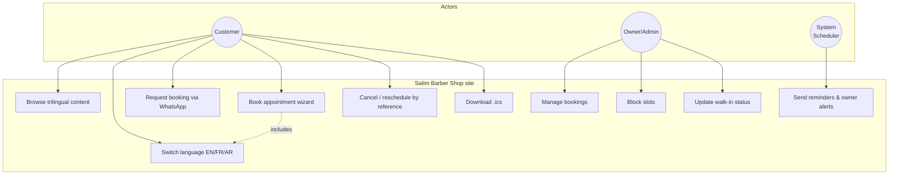
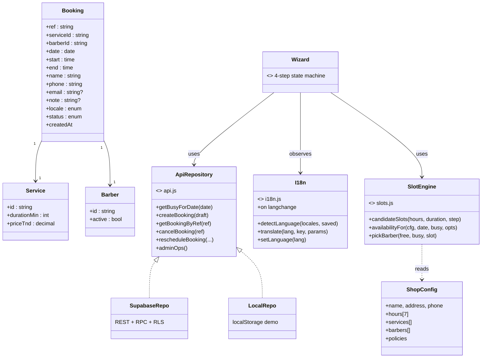
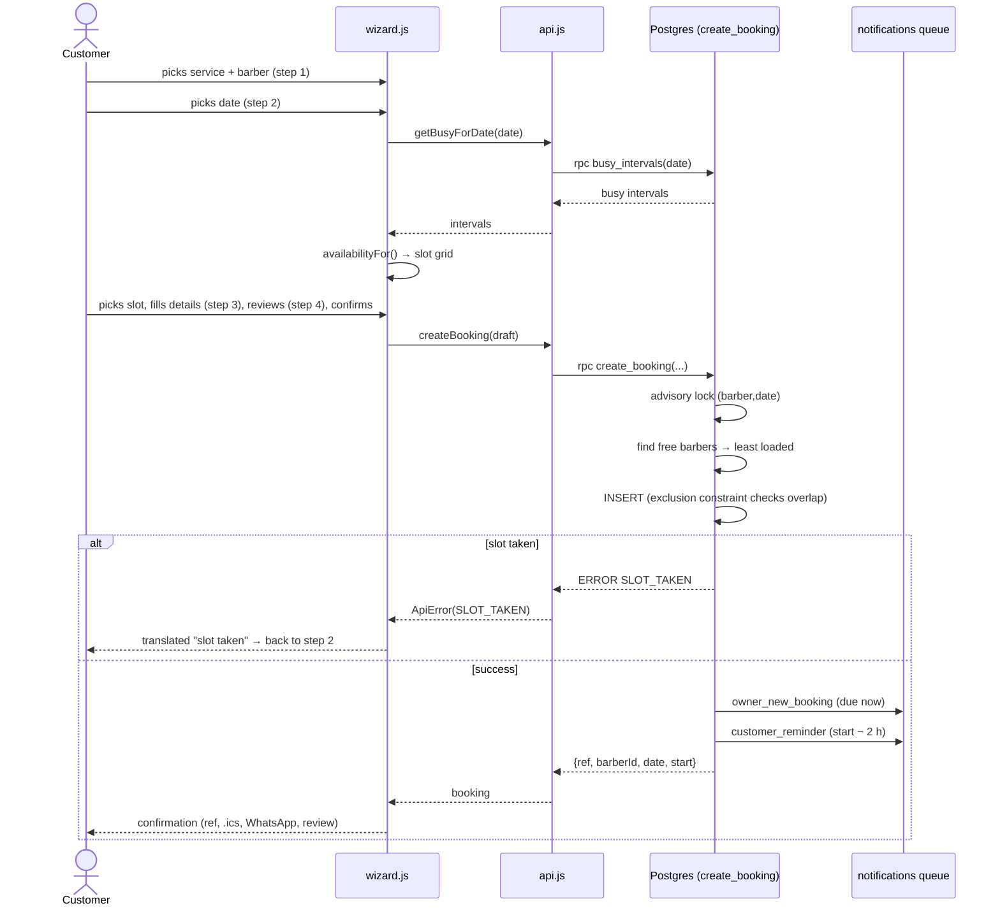
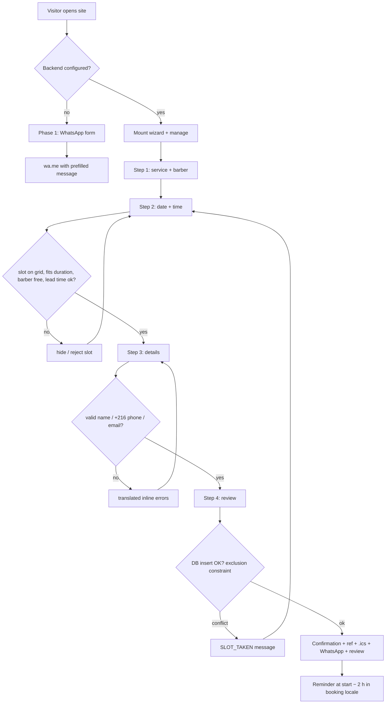
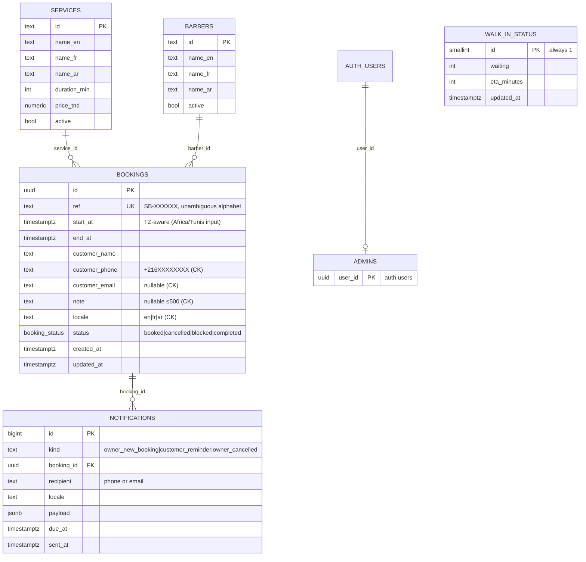

# Design Document — Salim Barber Shop

**Version:** 2.0 · Companion to `SRS.md`. Diagrams are Mermaid (render on GitHub).

---

## 1. Architecture

### 1.1 Choice: layered client–server with a static-first frontend

```
┌──────────────────────────── Browser (PWA) ────────────────────────────┐
│  UI layer        index.html / admin.html + css/styles.css (RTL-ready) │
│  Presentation    js/main.js · wizard.js · manage.js · admin.js        │
│  Business logic  js/slots.js · validation.js · shopTime.js            │
│  Data access     js/api.js  (Repository — Supabase | localStorage)    │
└───────────────┬───────────────────────────────────────────────────────┘
                │ HTTPS (REST/RPC, anon key)         HTTPS (Deno)
        ┌───────▼─────────────┐            ┌─────────────────────────┐
        │ Supabase            │            │ Edge Functions (cron)   │
        │  Postgres + RLS     │◄──notifications queue── send-reminders│
        │  RPC create_booking │            │  WhatsApp / Email APIs  │
        └─────────────────────┘            └─────────────────────────┘
```

**Why this and not MVC/framework:** the deliverable is a content + booking
site for a team of one. Vanilla ES modules ship ~40 KB of JS (no build step,
no hydration), hit Lighthouse ≥ 90 targets, and any static host serves them.
Layering is preserved by *module boundaries* (UI never touches SQL; business
logic is pure and unit-testable). Phase 2 "backend" is data + constraints +
scheduled jobs, which Supabase provides without running a server (ADR-002).

### 1.2 Tech stack
| Layer | Choice | Why |
|---|---|---|
| Markup/style | Semantic HTML5, modern CSS (custom props, grid/flex, **logical properties**) | RTL mirroring for free; no framework tax |
| Logic | Vanilla ES modules (no build) | perf, portability, owner-editable |
| i18n | JSON dictionaries + tiny engine (`i18n.js`) | one structure to edit; parity-testable |
| Fonts | Inter (EN/FR) + Cairo (AR) via Google Fonts `display=swap` | brief requirement; system fallbacks |
| DB/Backend | Supabase (Postgres + RLS + Edge Functions) | real constraints/transactions → FR-07; free tier; SQL = ER diagram 1:1 |
| Notifications | WhatsApp Cloud API + Resend (both optional) | channel the shop already uses |
| Hosting | Netlify (primary) / Vercel / GH Pages | free CDN, header control (CSP/HSTS) |
| Tests | node:test (unit, 0 deps) + Playwright (e2e) | CI without heavyweight setup |

### 1.3 Folder structure & separation of concerns
```
├── index.html            UI shell, SEO, JSON-LD          (UI)
├── admin.html            admin UI shell                   (UI)
├── css/styles.css        theme + layout, logical props    (UI)
├── js/
│   ├── config.js         ★ ALL business data (owner edits)
│   ├── i18n.js           language engine                  (i18n)
│   ├── translations/     en.json fr.json ar.json          (i18n data)
│   ├── shopTime.js       Africa/Tunis date/time helpers   (logic)
│   ├── slots.js          slot generation (pure)           (logic)
│   ├── validation.js     input validation (pure)          (logic)
│   ├── whatsapp.js       message builder + wa.me link     (logic)
│   ├── ics.js            calendar file                    (logic)
│   ├── api.js            Repository: Supabase|localStorage(data access)
│   ├── booking.js        Phase 1 form                     (presentation)
│   ├── wizard.js         Phase 2 wizard                   (presentation)
│   ├── manage.js         cancel/reschedule                (presentation)
│   ├── admin.js          admin dashboard                  (presentation)
│   ├── ui.js             toast/escape helpers             (presentation)
│   └── main.js           orchestrator                     (presentation)
├── sw.js · manifest.webmanifest        PWA
├── backend/supabase/schema.sql         DB, RLS, RPCs     (server)
├── backend/supabase/seed.sql           services/barbers  (server)
├── backend/functions/                  Deno edge fns     (server)
├── api/openapi.yaml                    API contract
├── tests/unit · tests/e2e              test pyramid
├── scripts/                            check/serve/icons
└── docs/                               this documentation set
```

### 1.4 Patterns applied
| Pattern | Where |
|---|---|
| **Repository** | `api.js` — one interface, two backends (Supabase / localStorage); UI never knows which |
| **Strategy** | availability: per-barber vs "any barber" union inside `availabilityFor()`; notification channels (WhatsApp/email) in `send-reminders` |
| **Observer** | `sb:langchange` event — every module re-renders itself on language switch without coupling |
| **Facade** | `whatsapp.js` / `ics.js` wrap message + file formats |
| **Progressive enhancement** | Phase 2 modules dynamically imported only when backend configured |
| **SOLID highlights** | S: each module one concern; O: new language/service = new data, no code change; L/D: UI depends on `api.js` interface, not a backend; DIP: `availabilityFor` depends on injected `cfg` (testable) |

DRY: services/barbers/prices defined once (`config.js` mirrors `seed.sql`,
asserted by `config.test.js`); KISS: no state library — one wizard state object.

---

## 2. UML diagrams

### 2.1 Use case diagram


### 2.2 Class diagram (domain)


### 2.3 Sequence diagram — booking flow (Phase 2, happy path + conflict)


### 2.4 Activity diagram — booking decision flow


### 2.5 ER diagram (Postgres)


**Constraints & indexes** (see `schema.sql`): `ref` UNIQUE; `CHECK` on phone
`^\+216[2459]\d{7}$`, email, note length, locale enum; **exclusion constraint**
`bookings_no_overlap (barber_id WITH =, tstzrange(start_at,end_at) WITH &&)
WHERE status IN ('booked','blocked')` — the double-booking guard; indexes on
`start_at`, `(barber_id,start_at)`, `customer_phone`, `due_at WHERE sent_at IS NULL`.

---

## 3. Timezone policy
- All business times travel as **naive strings** `"YYYY-MM-DD"`/`"HH:MM"`
  expressed in **Africa/Tunis** (`SHOP.timezone`), decided once, everywhere.
- `shopNow()` derives "now" in the shop's zone from any visitor clock (Intl).
- DB stores `timestamptz`; RPCs convert with `(p_date + p_start) AT TIME ZONE
  'Africa/Tunis'`. `.ics` uses `DTSTART;TZID=Africa/Tunis`. Unit-tested
  (`shopTime.test.js` asserts the +01:00 conversion).

---

## 4. Slot-generation algorithm (step by step)

Inputs: shop hours for the weekday, service duration `D`, grid step `S=15`,
busy set `B` (bookings + blocks with barber), now `T` (shop tz), barber `b`
(or "any").

1. **Grid:** candidates = `open, open+S, …` while `start + D ≤ close`
   (a 45-min service stops 45 min before closing).
2. **Lead time:** if date is today, drop candidates with `start < T + 30 min`.
3. **Overlap:** for each candidate, per barber `x ∈ selected`: busy if any
   `b ∈ B` with `b.barberId = x` and `start < b.end ∧ b.start < end`.
4. **Union ("any barber"):** keep the slot if ≥ 1 selected barber is free;
   record the free set.
5. **Assignment:** at confirmation, `pickBarber` takes the **least-loaded**
   free barber (fewest bookings that day) — balances the chairs.
6. **Closed days:** weekday with `hours = null` → no candidates (chips disabled).

**Concurrency (double-booking) handling — three layers:**
1. *UX:* slots already taken are hidden/disabled (prevents most conflicts).
2. *Application:* `create_booking` takes `pg_advisory_xact_lock(hash(barber,
   date))` so concurrent "any barber" requests serialize their free-barber
   check + insert (they can't both claim the last chair).
3. *Database:* the **exclusion constraint** is authoritative — even a buggy or
   malicious client inserting directly cannot create an overlap; the loser
   surfaces as `SLOT_TAKEN` → HTTP 409 → wizard shows the translated retry.

---

## 5. API specification
Full machine-readable contract: [`api/openapi.yaml`](../api/openapi.yaml)
(OpenAPI 3.1). Summary:

| Operation | Route (Supabase RPC/REST) | Auth | Success | Errors |
|---|---|---|---|---|
| Busy intervals | `POST /rpc/busy_intervals` | anon | 200 `[{start,end,barber_id,status}]` | — |
| Available slots | `POST /rpc/available_slots` | anon | 200 `[{slot, free_barbers}]` | — |
| Create booking | `POST /rpc/create_booking` | anon | 200 booking json | 409 SLOT_TAKEN · 400 BAD_SERVICE/SLOT_PAST/TOO_MANY_ACTIVE |
| Get booking | `POST /rpc/get_booking` | anon (ref = capability) | 200 booking/null | — |
| Cancel | `POST /rpc/cancel_booking` | anon (≤3 h) / admin force | 200 `{ok}` | 404 NOT_FOUND · 403 CANCEL_WINDOW_EXPIRED |
| Reschedule | `POST /rpc/reschedule_booking` | anon | 200 `{ok,ref}` | 404 · 409 · 403 |
| Admin list | `GET /bookings_view` | admin JWT | 200 rows | 401 |
| Block slot | `POST /rpc/block_slot` | admin JWT | 200 `{ok,ref}` | 403 FORBIDDEN · 409 |
| Walk-in get/set | `GET /walk_in_status` · `POST /rpc/update_walk_in` | anon / admin | 200 | 403 |

Error format (Supabase REST): `{ "code": "SLOT_TAKEN", "message": "…" }`
mapped client-side to translated messages; never leaks PII.

---

## 6. Security design (OWASP Top 10 mapping)
| OWASP | Control |
|---|---|
| A01 Broken access control | RLS on every table; anon can only call guarded RPCs; `bookings_view` filters `is_admin()`; service-role key never leaves the server |
| A02 Crypto failures | HTTPS-only + HSTS; bcrypt-hashed passwords by Supabase Auth; secrets in env/Supabase secrets |
| A03 Injection | PLpgSQL RPCs with typed parameters (no string SQL); all injected HTML escaped (`escapeHtml`); CSP blocks inline scripts |
| A04 Insecure design | ref = 30-bit unambiguous capability; rate-limit 3 active bookings/phone; honeypot; cancel window enforced server-side |
| A05 Misconfiguration | security headers (CSP/HSTS/XFO/nosniff) in netlify.toml/vercel.json; `noindex` on admin |
| A06 Vulnerable deps | zero runtime dependencies in the frontend; CI audits via npm |
| A07 Auth failures | admin = Supabase Auth (email+password, strength policy); session token in sessionStorage, short TTL |
| A08 Integrity | CI-deployed artifacts only; signed commits recommended |
| A09 Logging | structured logs without PII (notification errors log ids, not phones) |
| A10 SSRF | no user-supplied URLs fetched server-side |

**Data protection:** minimal fields (name, phone, optional email/note), stated
purpose (privacy notice ×3 languages), Tunisian Organic Law 2004-63 + GDPR
principles, deletion on request (cancel + purge job), backups via Supabase
daily snapshots (free tier PITR window) — see MAINTENANCE_GUIDE.md.

---

## 7. PWA design
- `manifest.webmanifest`: identity, gold/dark icons (any + maskable), shortcut
  "Book" → `#booking`; `start_url=./?source=pwa`.
- `sw.js`: versioned cache (`sb-v1`); **cache-first** static assets,
  **network-first** navigations with offline fallback, **never caches** API
  calls or non-GET (bookings always live). Bump `CACHE_VERSION` per release.
- Install prompt: standard browser prompt on HTTPS + engagement; no custom UI.

---

## 8. Analytics (privacy-friendly)
`i18n.js` calls `window.__sbAnalytics?.('language', { lang })` on every
language init/switch — a no-op stub by default. Wire it to a cookieless,
self-hostable counter (e.g., Plausible/Umami) recording only the language
dimension; no cookies, no fingerprints, no PII (GDPR/2004-63-friendly).
